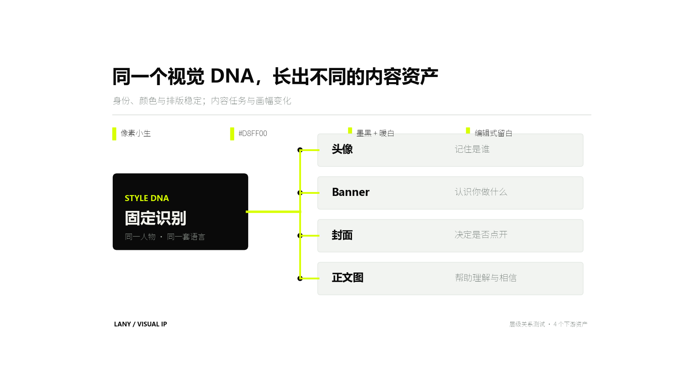
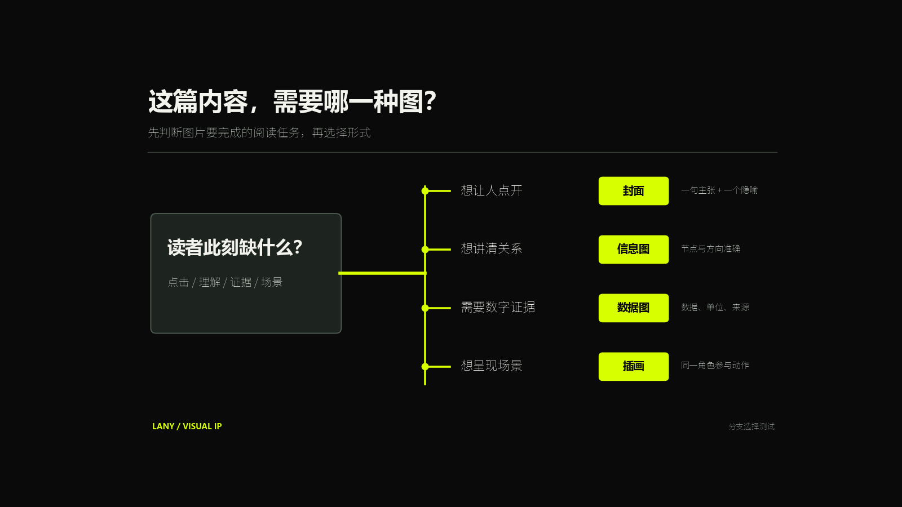
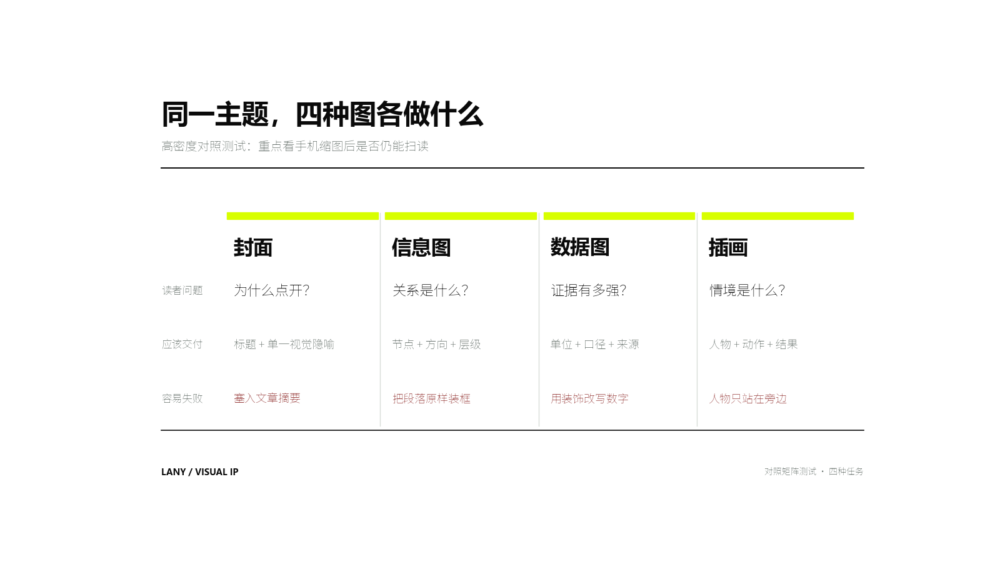
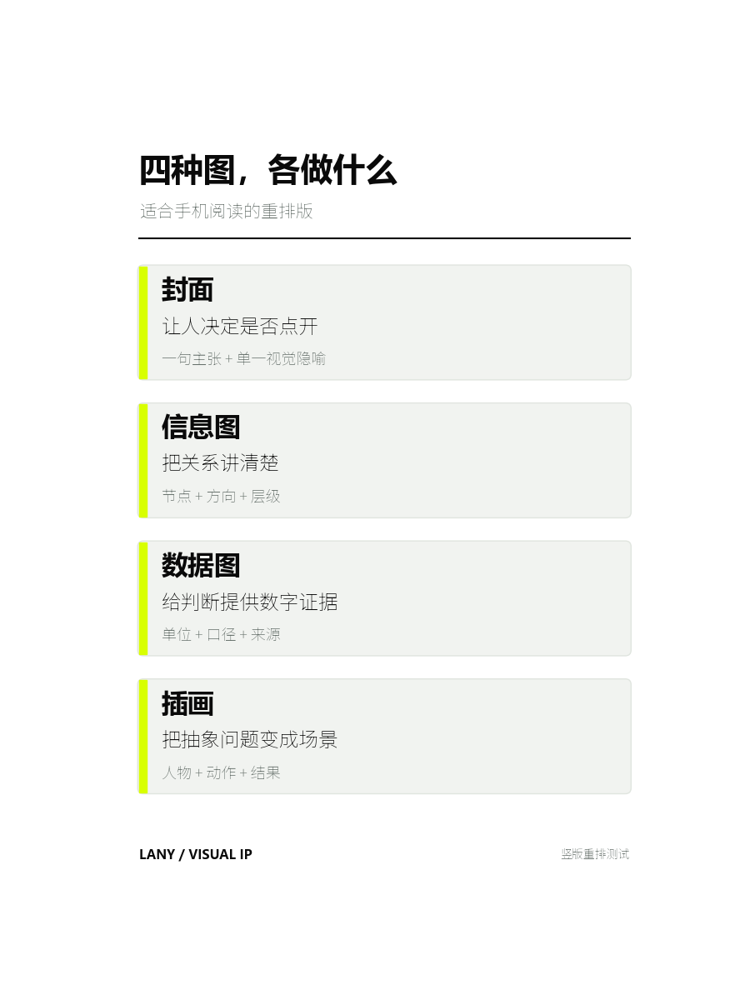

# Lany Infographics

`$lany-infographics` 把文章、工具教程和复杂概念整理成品牌一致的流程图、关系图、层级图、对比图和时间线。它负责解释结构；主要由数字构成的内容交给 `$lany-data-charts`。

默认视觉使用 Lany 小生的黑 / 白 / 荧光黄绿 `#D8FF00` 系统。重要文字与节点优先用可编辑的 SVG、HTML/CSS 或绘图代码制作，以保证中文和关系准确；人物只在确实参与核心动作时出现。

## 安装与更新

这是供 Agent 读取的技能包。仓库提供工作流、参考规范和示例资源，没有独立网页或一键生成服务。

### Codex 安装

在终端执行（macOS / Linux）：

```sh
mkdir -p ~/.agents/skills
git clone https://github.com/LanyXiaosheng/lany-infographics-skill.git ~/.agents/skills/lany-infographics
```

安装后在对话里使用 `$lany-infographics`。技能名没有仓库名末尾的 `-skill`。Codex 会自动检测技能；未显示时重启后再试。安装路径与发现规则参见 [OpenAI 官方技能文档](https://learn.chatgpt.com/docs/build-skills)。

如果此前已安装到 `~/.codex/skills/lany-infographics` 且能正常调用，可沿用现有目录。只保留一份同名技能，不要重复安装；下方更新命令也要改成你的实际路径。目标目录已存在时，先检查其中的文件，勿直接覆盖自定义内容。

### 更新

先查看本地修改：

```sh
git -C ~/.agents/skills/lany-infographics status --short
```

工作区无修改后执行；有修改时先提交或备份并处理：

```sh
git -C ~/.agents/skills/lany-infographics pull --ff-only
```

其他 Agent 可按其技能目录规则安装整个文件夹，或让它读取 [SKILL.md](SKILL.md) 并遵循工作流。只复制 SKILL.md 会缺少参考文件和资源；调用语法与工具能力以宿主为准。

## 运行条件

- Agent 能读取输入文件、创建输出文件，并运行绘图代码或导出 SVG/HTML。
- 导出 PNG 需要宿主已有的 SVG 渲染器、浏览器截图或绘图库；此仓库没有绑定特定渲染器和依赖版本。
- 中文标签需要运行环境中可用的中文字体，导出后检查是否缺字。
- 默认用代码或 SVG/HTML 绘图，无需图片生成工具。仅在额外制作人物或氛围插画时需要宿主提供生图能力。
- 网页数据、远程材料和额外文件格式需要宿主具备相应读取能力；只给网址但无法访问时，请提供正文或数据文件。

## 准备哪些输入

| 输入 | 说明 |
| --- | --- |
| 材料 | 文章正文、Markdown 文件、工具流程或明确的实体关系；有来源链接时一并提供 |
| 读者问题 | 看完图要理解的一件事，例如“用户反馈如何进入下一轮开发？” |
| 节点与关系 | 已知步骤、依赖、条件和方向；尚未确定的内容要标为假设 |
| 发布场景 | 默认文章配图 16:9；手机信息流可指定 3:4 竖版 |
| 保存位置 | 项目根目录、主题名；需要写入文章时提供准确 Markdown 路径 |

材料较长时，Agent 先提取节点与关系，再确定图数。每张图只解释一个关系；用真实材料支持图中的结论。

## 快速使用

```text
使用 $lany-infographics，把下面的内容整理成一张适合 X 长文的 16:9 信息图。

读者看完需要理解：<一句话>
内容：<文章、段落、流程或关系>
输出：PNG + 可编辑 SVG；使用 Lany 黑白荧光绿视觉。
```

```text
使用 $lany-infographics 先分析这篇文章，决定最需要解释的 1—3 个关系，生成信息图计划并逐张出图。每张图只解释一个关系，并报告建议插入的正文段落。不要把图片堆到文末。

文章：<文件路径或正文>
```

以下图片是已有演示资源，用于说明结构与版式，不代表每次调用都会生成完全相同的图。

## 示例 1：层级关系

适合回答“一个共同来源如何影响多个下游”。

```text
使用 $lany-infographics 制作一张 16:9 层级关系图。

核心结论：同一个视觉 DNA，可以长出头像、Banner、封面和正文图。
上游规则：像素小生、#D8FF00、墨黑与暖白、编辑式留白。
下游资产：
1. 头像——记住是谁
2. Banner——认识你做什么
3. 封面——决定是否点开
4. 正文图——帮助理解与相信

要求：关系方向唯一，文字准确，PNG 与可编辑 SVG 同时保存。
```



## 示例 2：选择分支

适合把一个决策拆成有限分支。

```text
使用 $lany-infographics 制作一张 16:9 选择分支图，标题为“这篇内容，需要哪一种图？”。

起点：读者此刻缺什么？
- 想让人点开 → 封面 → 一句主张 + 一个视觉隐喻
- 想讲清关系 → 信息图 → 节点 + 方向 + 层级
- 需要数字证据 → 数据图 → 数据 + 单位 + 来源
- 想呈现场景 → 插画 → 人物 + 动作 + 结果

使用深色 Lany 视觉，让四个结果标签在手机缩图里优先可读。
```



## 示例 3：高密度横向对照

适合桌面阅读或文章内可点开放大的对照内容。

```text
使用 $lany-infographics 制作一张 16:9 四列对照矩阵。

列：封面 / 信息图 / 数据图 / 插画。
行：读者问题 / 应该交付 / 容易失败。
内容：
- 封面：为什么点开？/ 标题 + 单一视觉隐喻 / 塞入文章摘要
- 信息图：关系是什么？/ 节点 + 方向 + 层级 / 把段落原样装框
- 数据图：证据有多强？/ 单位 + 口径 + 来源 / 用装饰改写数字
- 插画：情境是什么？/ 人物 + 动作 + 结果 / 人物只站在旁边

输出 PNG 与可编辑 SVG，并额外导出 400px 宽预览检查手机可读性。
```



## 示例 4：竖版重排

横向四列在手机信息流里会变得太小。竖版需要重新组织层级，不能直接裁切横图。

```text
使用 $lany-infographics 把上面的四列对照改成 3:4 竖版。

每一类做成一张纵向卡片，只保留：类别、读者需要、应交付内容。删除“容易失败”一行，保证 400px 宽仍能读清四个分类和主要说明。输出 PNG 与 SVG。
```



## 已观察到的边界

- 16:9 下四个主节点、四个分支和四列大标题表现稳定。
- 横向四列同时放三层文字时，缩到 400px 宽只能认出大标题；细节需要点开。
- 竖版逐项排布更适合手机，但第三层浅色注释仍不应过长。
- 超过约 5 个节点、出现交叉连线，或每个节点需要一整段解释时，应拆成多张图或改成交互页面。
- 信息图可以展示关系与流程，不能代替数据图的单位、口径和来源。

完整规则见 [SKILL.md](SKILL.md) 与 [diagram-rules.md](references/diagram-rules.md)。

## 输出与验收

默认保存到 `<项目根>/lany-assets/lany-infographics/<slug>/`，其中 `<slug>` 是本次主题名。请在任务中明确项目根目录，文件名可按主题确定；同名文件使用版本后缀。

| 交付物 | 内容 |
| --- | --- |
| 图的结论 | 一句话核心关系、节点清单与来源；区分事实和假设 |
| 可编辑源文件 | SVG 或固定尺寸 HTML/CSS，保留准确文字、连线和层级 |
| 发布图片 | PNG，默认 16:9；需要手机发布时另做竖版重排和缩图检查 |
| 文章插入建议 | 对应正文段落、建议插入位置和文件路径 |

先逐项检查箭头方向、条件分支、比较维度和标签，再检查中文、尺寸与手机可读性。人物只在参与核心动作时出现，避免装饰占用关系图空间。

需要直接写入 Markdown 时可复制这句补充要求：

```text
将生成的信息图插到指定文章中对应解释段落之后。先备份原文，再使用相对于文章位置的图片路径插入；完成后检查路径和 Markdown 语法，不把多张图集中堆到文末。
```

## 常见问题

- **和数据图有什么区别？** 本技能解释步骤、方向、层级与关系。数值比较、占比和趋势使用 `lany-data-charts`，它会检查单位、口径和数据来源。
- **能只做结构方案吗？** 可以。在请求中写明“只给结论、节点、连线关系和布局，不生成图片”。
- **节点太多怎么办？** 优先拆成多张图或分层说明；不要把文章每一段直接装进框里。
- **能用图片生成模型画整张图吗？** 可用它制作氛围插画，但关键文字和关系应保留在 SVG/HTML 等可编辑文件中，便于修正。
- **没有生图能力还能用吗？** 可以。默认流程用代码、SVG 或 HTML 绘制结构图；PNG 导出仍需宿主有渲染工具。
- **导出后中文缺字或缩图太小？** 换用可用中文字体并重新导出；缩短节点标签、拆图或做竖版重排，不能只裁掉横图边缘。
- **安装后找不到技能？** 检查安装目录中直接存在 SKILL.md，调用 `$lany-infographics`；避免同名重复安装，未识别时重启 Codex。

## 仓库内容

- [SKILL.md](SKILL.md)：工作流、写入文章规则和交付要求。
- [信息图规则](references/diagram-rules.md)：视觉规范与结构选择。
- [头像参考](assets/lany-avatar-reference.png)：可选人物参考。
- [示例图片](docs/images/)：本文四种版式的已有演示图。
- [Agent 元数据](agents/openai.yaml)：显示名称与默认提示词。
- [设计说明](DESIGN.md)：独立发布的结构与边界。

## 配合使用

真实数据证据交给 [Lany Data Charts](https://github.com/LanyXiaosheng/lany-data-charts-skill)；人物与动作场景交给 [Lany IP Article Illustrations](https://github.com/LanyXiaosheng/lany-ip-article-illustrations-skill)；特殊中文标题可搭配 [Lany Typography Prompts](https://github.com/LanyXiaosheng/lany-typography-prompts-skill)。按任务选择即可，无需全部安装。

来源：[lany-skills/lany-infographics](https://github.com/LanyXiaosheng/lany-skills/tree/master/lany-infographics)。
